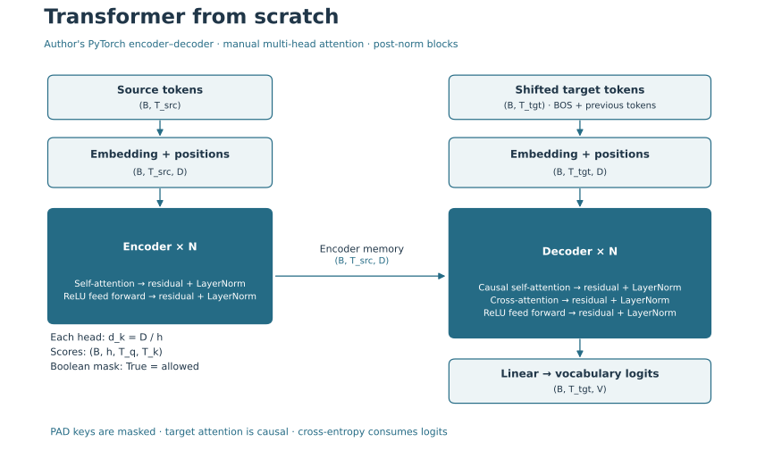
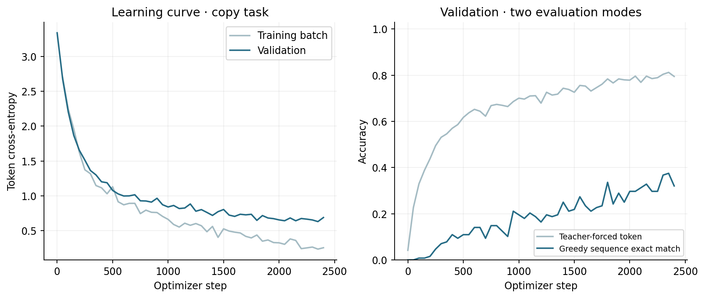

# Transformer From Scratch · PyTorch

**Авторский encoder–decoder Transformer с ручным Multi-Head Attention.**
Реализация перенесена из предоставленного архива; классы и вычислительная архитектура сохранены.
Исправлены masks, добавлены 19 тестов, обучение и autoregressive generation.
Не используется готовый `nn.Transformer` или `nn.MultiheadAttention`.



`Input → Embedding + Positional Encoding → Encoder → Decoder → Linear → Vocabulary`

Source проходит в encoder; decoder получает BOS и сдвинутые target-токены,
а также память encoder через cross-attention. Linear возвращает logits по словарю.

## Что сохранено и что исправлено

Авторские Q/K/V и W_o projections, разбиение heads, scaled dot-product attention,
encoder/decoder blocks, ReLU Feed Forward Network, residual connections,
post-norm LayerNorm и sinusoidal positional encoding сохранены.
Девять исходных файлов лежат в [docs/original/](docs/original/), с проверяемыми SHA-256.
Файлы учебных заданий и виртуальные окружения из архива не включены.

Главная ошибка исходного attention — `unsqueeze_` изменял маску вызывающего кода:
при повторном использовании в нескольких blocks её rank увеличивался.
Теперь нормализация mask не изменяет вход. Также автоматически создаются causal mask
для target и key padding mask для source/target. Полностью закрытые строки attention
не порождают NaN. Подробности и предложения: [review.md](docs/review.md).

## Архитектура и формы тензоров

`B` — batch size; `T` — sequence length; `D` — d_model; `V` — vocabulary size;
`h` — number of heads; `d_k = D / h`; `N` — число Transformer blocks.
`T_src` и `T_tgt` могут различаться.

| Компонент | Форма |
|---|---|
| Input tokens | `(B, T_src)` / `(B, T_tgt)` |
| Embedding + positional encoding | `(B, T, D)` |
| Q/K/V после разделения heads | `(B, h, T, d_k)` |
| Self-attention scores | `(B, h, T, T)` |
| Decoder cross-attention scores | `(B, h, T_tgt, T_src)` |
| Feed Forward Network | `(B, T, D)` → `(B, T, D_ff)` → `(B, T, D)` |
| Linear output logits | `(B, T_tgt, V)` |

Encoder block: `Self-attention → Add + LayerNorm → FFN → Add + LayerNorm`.
Decoder block: `Causal self-attention → Add + LayerNorm → Cross-attention → Add + LayerNorm → FFN → Add + LayerNorm`.
LayerNorm применяется **после** сложения residual. Dropout остаётся в embedding;
attention/residual dropout из оригинальной статьи пока не добавлены.

$$Attention(Q,K,V) = softmax(QK^T / \sqrt{d_k} + M)V$$

Boolean masks в коде: **True разрешает**, False закрывает attention.
Source padding mask: `(B, 1, 1, T_src)`; combined target mask: `(B, 1, T_tgt, T_tgt)`.
Верхний треугольник target mask закрыт, поэтому будущие target-токены недоступны.
На fully masked строках веса принудительно равны нулю; выход W_o может содержать bias.
Loss не учитывает PAD. Дополнительные сведения: [architecture.md](docs/architecture.md).

## Реально выполненное обучение

Задача **синтетического копирования последовательности**, а не перевод или real-text NLP benchmark.
Она проверяет, что attention, masks, teacher forcing, backpropagation и генерация работают вместе.
Каждая последовательность содержит 3–7 token IDs из `[3, 23]`; PAD=0, BOS=1, EOS=2.
Словарь V=24. Целевая последовательность совпадает с source; EOS должен быть сгенерирован.

- Train: **1024**, validation: **128**, final test: **128** уникальных последовательностей без пересечений.
- Train seed=42, validation seed=43, final test seed=45.
- D=32, h=4, d_k=8, D_ff=64, N=2, max_len=16, embedding dropout=0.1.
- Параметров: **45,080**. CPU, PyTorch **2.8.0+cpu**.
- Adam lr=0.001, batch=64, gradient clipping=1.0, **2400 steps**.
- Target input = BOS + предыдущие токены; labels = следующие токены + EOS.
- CrossEntropyLoss принимает logits, `ignore_index=PAD`. Softmax перед loss не используется.
- Checkpoint выбран по минимальному validation loss на step **2350**.
  Test оценивается после выбора checkpoint.

Первый эксперимент длился 600 steps и сохранён в [reports/experiments/600_steps/](reports/experiments/600_steps/).
Из-за ещё снижающегося validation loss длительность обучения увеличена.
Его прежний holdout seed=44 исключён из новой финальной test-выборки seed=45.
Архитектура и learning rate между экспериментами не менялись.

| Оценка | Фактическое значение |
|---|---:|
| Initial validation cross-entropy | 3.3370 |
| Selected validation cross-entropy | 0.6312 |
| Final test cross-entropy | 0.6317 |
| Final test teacher-forced token accuracy | 80.876% |
| Final test greedy sequence exact match | 32.812% |

Teacher-forced token accuracy получает правильный предыдущий target-токен.
Greedy exact match генерирует **всю последовательность самостоятельно**, включая EOS;
одна неверная позиция делает весь пример ошибочным. Поэтому две метрики нельзя смешивать.



- Успешный пример: input `[16, 18, 11, 5, 12]` → generated `[16, 18, 11, 5, 12]`; EOS: `True`.
- Ошибка: input `[3, 5, 18, 3, 6]` → generated `[3, 5, 18, 6]`; EOS: `True`.

Все 128 примеров доступны в [test_generations.json](reports/test_generations.json).
Greedy exact match 32.8% остаётся ограниченным: разрыв с token accuracy показывает,
что корректный следующий токен при teacher forcing ещё не гарантирует самостоятельное
копирование целиком. Training loss заметно ниже validation loss, поэтому дальнейшее
увеличение числа steps само по себе не устраняет ограничение обобщения.
Это не доказательство качества перевода или готовности модели к работе с текстом.
Поведение проверено на небольшой конфигурации CPU; перенос на GPU и длинные тексты отдельно не оценивался.

## Тестирование

19 тестов: независимая сверка attention через einsum, разные T_src/T_tgt,
causal invariance, padding keys, неизменность повторно переданных masks,
finite forward/backward, градиенты через encoder/decoder/FFN, state_dict,
dropout train/eval, odd D positional encoding, некорректные heads/masks/длина,
раздельные datasets, tiny overfit и побайтное сохранение авторского исходника.

## Запуск после клонирования

Python 3.12, команды из корня репозитория:

```bash
python -m venv .venv
# Windows PowerShell: .venv\Scripts\Activate.ps1
# macOS/Linux: source .venv/bin/activate
python -m pip install -r requirements-lock.txt
python -m pytest -q
python train.py
python generate.py 3 7 12 4
```

Зафиксированный lock использует CPU-wheel из официального PyTorch index.
Обучение создаёт `checkpoints/copy_model.pt`; checkpoint не коммитится в Git.
В предоставленном локальном пакете обученные веса сохранены.
`generate.py` читает только state_dict и конфигурацию с `weights_only=True`.
Отдельные `--steps`, `--seed`, `--test-seed`, `--device` позволяют создать новый эксперимент,
но изменённая конфигурация уже не воспроизводит таблицу выше.

```text
├── src/transformer/    # авторские классы + masks, copy task, training
├── tests/              # поведение модели и сохранность исходников
├── docs/original/      # девять исходных файлов
├── data/               # детерминированные synthetic splits
├── reports/            # history, metrics, generated examples
├── images/             # схема и learning curve
├── train.py
└── generate.py
```

## Ограничения и развитие

Соответствие оригинальной статье не заявляется полностью: отсутствуют её training recipe,
attention/residual dropout и реальный переводческий benchmark.
Следующий шаг — tokenizer и открытый корпус, отдельный data protocol, scheduler/warmup
и сравнение с простой seq2seq baseline. Изменения архитектуры стоит проверять отдельно
от текущих исправлений, сохраняя тесты masks и causality.

Статья: [Attention Is All You Need](https://arxiv.org/abs/1706.03762).
